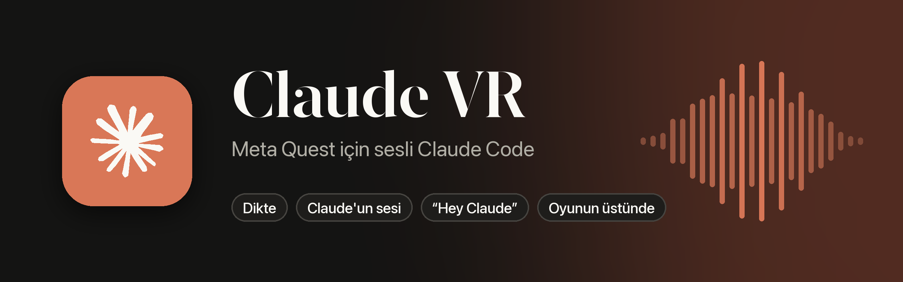
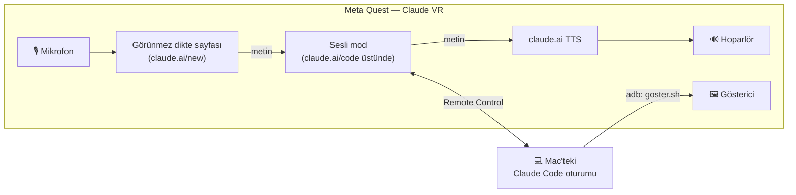

<p align="center">
  
</p>

<p align="center">
  
  
  
</p>

<p align="center">
  Gözlükteyken, hatta oyun oynarken, Mac'inde çalışan <b>Claude Code</b> oturumlarıyla sesle konuş.<br>
  Claude cevabını kendi sesiyle okur, altyazı ekranın altında akar.
</p>

> [!NOTE]
> Resmî bir Anthropic ürünü değildir, Anthropic ile bağlantısı yoktur. claude.ai'nin web arayüzünü kendi hesabınla kullanır.

---

## Neler yapar

| Özellik | Ne yapar |
|---|---|
| 🎙️ **Tıklamasız konuşma** | Konuşursun, sustuğunda mesaj gider. Claude bitirince cevabı okur, sonra yine dinler. |
| 👋 **"Hey Claude"** | Arkada sürekli dinler, yalnızca "Hey Claude" ile başlayan sözleri gönderir. Tek dokunuşla "her şeyi duy" moduna geçer. |
| 🔊 **Claude'un kendi sesi** | claude.ai'nin "Read aloud" sesi (44,1 kHz). Claude çalışırken yazdığı ara notları da anında okur. |
| ✋ **Araya girme** | Claude konuşurken konuşmaya başlarsan susar ve seni dinler. |
| 🎮 **Oyunun üstünde** | Seamless Multitasking penceresinde durur. Mikrofon, oyun öndeyken de açık kalır. |
| 🖼️ **Görsel ve video** | Mac'teki ajan gözlükteki pencerede resim, video, YouTube ya da HTML sayfası açabilir. |
| 👀 **Ekranı görme** | İstersen mesaja gözlükteki görüntünün son 5 saniyesinden kareler eklenir. |
| ✅ **İzin kartı** | Claude bir işlem için izin isterse ekranda kart çıkar, oradan onaylarsın. |
| 🔔 **Bildirim** | Uygulama önde değilken Claude bitirince ya da izin isteyince bildirim gelir. |
| ↩️ **Son oturum** | Uygulama en son kullandığın oturumla açılır. |

## Nasıl çalışır



- **Dikte**, claude.ai'nin kendi "Dictate" özelliğiyle yapılır. Remote Control oturumlarında bu düğme yok. Bu yüzden arkada görünmez bir `claude.ai/new` sayfası açık durur; dikte orada yapılır, metin oturumun yazı kutusuna aktarılır.
- **Ses**, Read aloud'un kullandığı TTS kanalından akış olarak gelir ve doğrudan çalınır. Düğmeye basmayı beklemez, ara mesajlar da okunur.
- Sesle giden her mesajın sonuna **`— Quest'ten sesli`** eklenir. Ajan kurallarına bir satır ekleyerek Claude'dan kısa ve sesli okunmaya uygun cevap isteyebilirsin.

## Kurulum

Gradle gerekmez. Android SDK (platform 36, build-tools) ve JDK 17+ yeter.

```bash
cd android && ./build.sh
adb install -r build/claude-ses.apk
```

- Quest'te **geliştirici modu** açık olmalı. Uygulama "Bilinmeyen kaynaklar" altında görünür.
- İlk derlemede `~/.android/claude-ses.keystore` ve yanında şifre dosyası oluşturulur. Bu dosyalar depoya girmez.
- İlk açılışta claude.ai'ye giriş yap, mikrofon ve bildirim izinlerini ver. Sonra bir Claude Code oturumu aç; sesli mod kendiliğinden başlar.

## Mac'ten görsel göstermek

```bash
tools/goster.sh resim.png "Başlık"      # yerel dosya: önce gözlüğe kopyalanır
tools/goster.sh https://…/video.mp4    # resim, video, YouTube ya da sayfa URL'si
tools/goster.sh --kapat
```

Betik kablosuz adb kullanır (varsayılan `192.168.1.12:5555`; `ANDROID_SERIAL` ile değiştir). Gözlük yeniden başlarsa kablosuz adb kapanır: bir kez USB ile bağlayıp `adb tcpip 5555` çalıştır.

## Proje yapısı

```
android/
  assets/overlay.js           sesli mod: arayüz, durum makinesi, TTS oynatıcı
  assets/dictate-helper.js    görünmez dikte sayfası (claude.ai/new)
  src/…/MainActivity.java     WebView, köprü, izinler, görsel/video gösterici
  src/…/MicService.java       oyun öndeyken mikrofonu koruyan ön plan servisi
  src/…/ScreenCaptureService  ekran kareleri (MediaProjection)
  src/…/WhisperClient.java    deneysel: Mac'teki whisper-server ile dikte, araya girme algılama
mac/                          deneysel: whisper-server'ı başlatan menü çubuğu uygulaması
tools/goster.sh               Mac'ten gözlükte görsel/video gösterme
mock/                         yerel test için sahte claude.ai sayfası
```

## Bilinen sınırlar

- claude.ai'nin arayüzü değiştikçe seçicilerin (`data-testid`, `aria-label`) güncellenmesi gerekir.
- Quest'in yerleşik konuşma tanıma ve seslendirme servisleri yalnızca İngilizce. Türkçe için claude.ai'nin kendi diktesi ve sesi kullanılıyor.
- Claude'un resmî Android uygulaması Quest'te açılmıyor (Play Integrity). Bu proje bu yüzden web arayüzünü kullanıyor.

## Lisans

[MIT](LICENSE) © Eymen Aktaş
